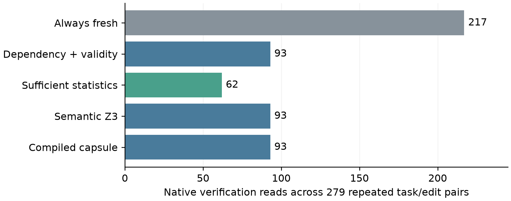
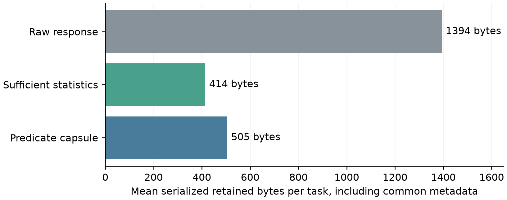

# VerifierShift restricted evidence pilot

This repository studies a practical verification tradeoff: retaining only typed predicate facts narrows what a downstream verifier receives, but a later policy may require source details that were discarded. The current November 1 study replays real public tau2 retail tool methods under nine controlled policy/state edits. It is a CPU-only interface and retention study; no model agent is evaluated in this new run.

## Results

Of 40 provider-test tasks, 31 have an executable first order-write trace. All 31 restricted native postconditions pass. Four tasks have no order write, four fail a preceding tool call and one fails the native write; the complete inclusion/exclusion record is saved. Nine edits per eligible task produce 279 repeated task/edit pairs and 1,395 method decisions.

| Method | Correct supported decisions | Unsupported cases sent to review | Verification reads |
|---|---:|---:|---:|
| Always fresh | 217/217 | 62/62 | 217 |
| Dependency and validity reuse | 217/217 | 62/62 | 93 |
| Retained sufficient statistics | 217/217 | 62/62 | 62 |
| Semantic Z3 entailment | 217/217 | 62/62 | 93 |
| Compiled predicate capsule | 217/217 | 62/62 | 93 |

Read totals count additional verification reads after the common initial capture; initial trace replay, capture and notification delivery are not included. The dependency, solver and compiled methods have exact decision/read parity. Retaining sufficient statistics uses fewer reads **and** fewer bytes: 414 mean serialized bytes, compared with 505 for the capsule and 1,394 for the raw response, including common provenance metadata. The capsule retains four predicate bits and no raw source scalars; those bits still disclose eligibility information. The result supports measuring disclosure constraints against decision coverage and refresh cost. It does not establish a superior caching algorithm or formal privacy.





## Read the manuscript

[Compiled paper](paper.pdf) · [Overleaf package](overleaf.zip). Upload `draft.tex`, `refs.bib` and `figures/` from the ZIP to Overleaf and select `draft.tex` with pdfLaTeX/BibTeX. `references.bib` is an identical compatibility copy. Editable LaTeX is distributed only inside the ZIP.

The paper reports the controlled public-tool study. The earlier authored-schema/model-judge paper and its submission-era artifacts are preserved under [legacy/authoritative_evidence_20261031](legacy/authoritative_evidence_20261031/). The author previously submitted that earlier VerifierShift manuscript to Preprints.org. Updating this repository does not alter that submission.

## Check saved results

Python 3 alone can check the frozen experiment hashes, all recorded decisions, denominators, exact baseline parity, retention arithmetic and saved audit records:

```sh
python3 verify_results.py
```

This check does not download a model or call a server. Its amount-cap checks use saved projection facts; the full replay below also runs a separately implemented oracle against the pinned upstream raw fixtures. Key files are:

- `runs/repair01-confirm-v2/summary.json`: current frozen results.
- `runs/repair01-confirm-v2/episodes.jsonl`: all 1,395 method decisions and read notices.
- `runs/repair01-confirm-v2/native_replay.json`: every task, including failures.
- `runs/repair01-confirm-v2/retention.json`: per-task byte/scalar accounting.
- `work/repair01_20261101/confirmation_freeze.json`: pre-confirmation code/protocol hashes.
- `audits/`: separately written raw-fixture arithmetic and complete replay comparison.
- `development_history/` and `runs/repair01-dev-*`: preserved development fixes and failures.

## Run the public-tool experiment

Use Python 3.12 or newer and Git. The single command creates a fresh output directory, obtains the exact public upstream commit, installs the small dependencies locally, executes the 40-task confirmation, runs the raw-fixture oracle, and compares decisions/read counts/retention with the frozen record:

```sh
sh run.sh
```

Select a particular compatible interpreter or a new output directory if needed:

```sh
PYTHON=python3.12 OUTPUT=runs/repair01-reproduce-my-run sh run.sh
```

The wrapper stops if the chosen output already exists. Network is used for the initial public-source/dependency downloads; workflow execution is local. The frozen result used Python 3.12.14 on macOS arm64. Microsecond timings vary across hosts and are excluded from reproduction equality. No API key, model download or cloud service is required.

## Regenerate the figures

```sh
python3 -m pip install -r requirements-figures.txt
python3 generate_figures.py
```

Plots read frozen results and record their source hash in `figure_data.json`. They do not execute workflows or model inference.

## Scope and next steps

The wrapper assumes a trusted post-authenticated caller context and complete field-change notices. It checks a restricted four-predicate fragment, not dialogue confirmation, payment settlement, the entire natural-language policy, actor authentication or task success. Hashes are local provenance bindings, not remote attestations. The edits are authored; they do not estimate natural policy-drift rates. The 31 tasks cover 28 orders and 25 callers, and 15 confirmation tasks share 13 orders with development. Results are task-held-out arithmetic/interface feasibility, not source-disjoint generalization. Repeated edits are not independent observations.

Future work will compare disclosure/coverage/read-cost frontiers on a larger source/caller-grouped corpus, add a second public workflow adapter, audit typed specifications independently, and retain strong sufficient-statistic and dependency baselines. A useful result must identify a real disclosure requirement under which the extra refresh cost is justified; projection should be preferred where it dominates. Bounded model-agent replication will be evaluated separately using native task evaluators.

## Earlier experiment

The original booking, inventory-dispatch and support-escalation study retains its unchanged code in `pilots/strengthening/` and recorded outcomes in `results/observed/`. Verify it with `python3 legacy_verify_results.py`. Its 168 model requests and 48 logical SQL worlds are separate from the current 1,395 deterministic method decisions.

## Attribution and citation

Saurav K. Aryal, Howard University, directed the research. Experiment implementation, execution, analysis and manuscript preparation used Codex assistance. `CITATION.cff` describes the current artifact. Public tau2 source/data retain Sierra Research's MIT terms; see `ATTRIBUTION.txt` and `UPSTREAM_LICENSES/`.

Repository: https://github.com/Saurav-K-Aryal/verifiershift-pilot
